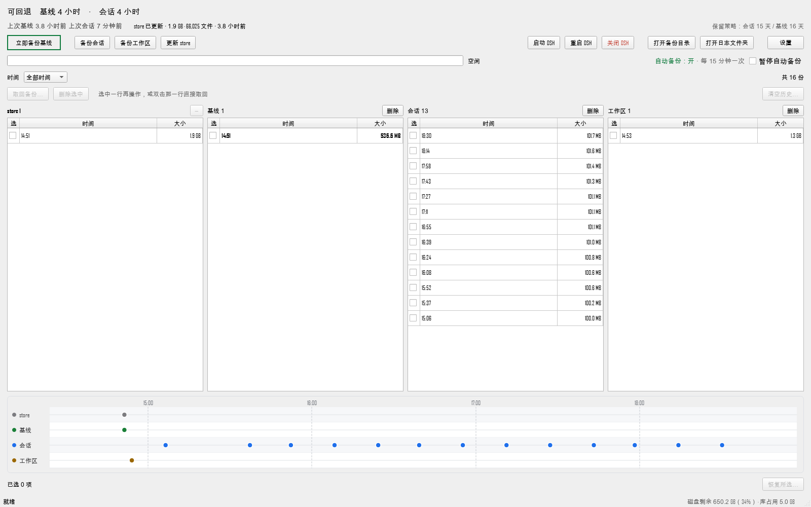

# DSHLauncher — 桌面版整包备份 / 一键回滚

[](LICENSE)


给**会把自己改坏的本地工程**做整包快照的桌面工具：不占端口、不要浏览器、不装数据库、不引入去重链。

把「昨天改坏了想回退」从「不知道动过什么」变成「选一个时间点，点恢复」。

> **English TL;DR** — A Windows desktop app that snapshots a local project into **complete, independent 7z archives** (no incremental or dedup chains — lose one, lose only that one), prunes them with a sparse retention policy that keeps the oldest, and restores with **file-by-file verification**. Four backup classes (source / config / sessions / workspace), an interactive timeline, and a stdio MCP server so an AI agent can drive it. Python + PySide6, backend is just `7z.exe` and `robocopy`. No server, no database, no browser.

本来是为 DeepSeek Harness（本地 AI agent 运行时）写的：要备 harness 源码 + 用户配置 + 会话日志 + 工作区四类。但四类的定义全在 `config.json` 里，换成任何「源码目录 + 配置目录 + 数据目录」的组合都能直接用。



- 每份包都是**独立完整**的 7z，不做增量、不做去重链、不做差量 ⇒ 少一份就少一份，不会连坐。
- 保留策略是稀疏保留（**留最老**），不是「桶内留最新」。
- 依赖只有 Python 标准库 + PySide6，后端调 `7z.exe` 和 `robocopy`。

---

## 1. 跑起来

```bat
git clone <this-repo> DSHLauncher
cd DSHLauncher
pip install PySide6
启动.cmd
```

第一次运行会把 `config.example.json` 复制成 `data\config.json`，然后开窗口。

**先把 `config.json` 里的路径改成你自己的**（工具不猜任何路径）：

| 字段 | 填什么 |
|---|---|
| `paths.backup_root` | 备份库放哪，几百 MB 到几 GB。默认 `data\` |
| `paths.dsh_home` | DSH 的用户目录，通常 `%USERPROFILE%\.dsh` |
| `paths.checkout` | DSH 源码 checkout（`package.json` 在那一层） |
| `paths.pnpm_store` | pnpm 全局包仓库；不确定就留空，store 那类会跳过 |
| `paths.workspace` | 要备份的工作区目录 |
| `paths.dsh_cmd` | 网关启动入口，默认 `%USERPROFILE%\.dsh\bin\DSH.cmd` |

留空的项**不算配置错误**，只是对应那一类备份会跳过并在界面上提示。只校验配置、不开窗口：

```bat
python launcher.py --check
```

> Windows 应用商店的 `python.exe` 是空壳别名，直接敲 `python` 可能报 "Python was not found"。用 `启动.cmd`，或写全解释器路径。

---

## 2. 备份了什么

| 类型 | 内容 | 方式 | 节奏 | 保留 |
|---|---|---|---|---|
| **store** | `paths.pnpm_store`（pnpm 全局包仓库） | `robocopy` 镜像 | 跟随基线 | 1 份，永不轮转 |
| **baseline** | harness 源码 + `.dsh` | 7z | 每天 03:30 + 手工 | 稀疏保留，覆盖约 16 天 |
| **sessions** | `.dsh\sessions` | 7z | 每 15 分钟 | 稀疏保留，覆盖约 15 天 |
| **workspace** | `paths.workspace` | 7z | **纯手动** | 不自动清 |

baseline 会排掉的东西：

- harness 侧目录：`node_modules`、`.git`、`.vite`、`.vite-temp`、`.pnpm-task-run-state-v1`
- `.dsh` 侧目录：`sessions`（归 sessions 那类）、`voicebox-cache`
- `exclude_links` 里的目录联接（junction）——记进 `links.txt`，恢复时重建，不把被指向的内容压进包

**sessions 会先复制再压**。7z 直接压一个正在被写的目录会锁住文件，让网关那一轮写不进去（报 `EBUSY: resource busy or locked`）。所以 sessions 这类先 `shutil.copy2` 到 slot 里的 `_staging`，压副本，压完清掉。代价是多读一遍盘，换来「备份时网关不失败」。

---

## 3. 恢复

三种定位方式，界面走第一种：

1. **落回原路径** —— 界面里选中 → 恢复。恢复前可先「演练到临时目录」，逐文件比对完再落位。
2. **`dest`** —— 解到指定目录，不重定位，第一层是归档里的源目录名。
3. **`into` / `roots`** —— 把包铺到一棵新根下，按 `harness` / `dsh` / `workspace` 三个角色重定位。用 `into` 时 sessions 会落到 `<into>\.dsh\sessions`。

跨列勾选可以把「基线 14:51 + 会话 15:06 + 工作区 14:53」拼成一次恢复全做完。落位前一律先做 dry-run 预检，预检不过不写盘。

---

## 4. 时间轴

表格下面是四条泳道（store / 基线 / 会话 / 工作区），每份备份一个点。

- **横拖**平移，**滚轮**以光标处为中心缩放
- **点一下**圆点 → 上方表格选中那一行；该行不在当前时间筛选里时会自动切回「全部时间」
- **双击空白**回到全部范围，方向键平移，`Home` 复位
- 它吃**全量数据**，不受时间筛选影响——所以表格里只看到最近几天时，时间轴仍告诉你范围外还有东西

只有一个备份（或一个都没有）时铺一整天；有多个时按实际跨度铺，留 25% 余量。

---

## 5. 保留策略

`kinds.<kind>` 里四个字段：`c` 密集保留期、`D` 日保留期、`M` 分钟级上限、`interval`。

密集期内一份不删；过了密集期按「留最老」稀疏化。自动淘汰是**真删**，但会先写一条审计事件，并保留最后 `hold_delete_streak`（默认 2）次不删。

「暂停自动备份」开着时才能「清空历史」——半销毁操作，只在你自己明确要做的时候用。

---

## 6. 不开界面时

命令行：

```bat
python launcher.py --check          :: 只校验配置
python launcher.py --reset-config   :: 用默认值覆盖 config.json
```

MCP（`mcp_server.py`，stdio）：

| 工具 | 干什么 |
|---|---|
| `backup_status` | 库总览：各类份数、最新时间、库多大、磁盘剩余、下次基线时刻、端口状态 |
| `backup_list` | 列备份槽（slot / 时间 / 大小 / 文件数 / 是否完好） |
| `backup_run` | 立刻做一次（`kind` 必填） |
| `backup_delete` | 软删若干份，移进回收区，`confirm=true` 才动 |
| `backup_restore` | 演练恢复到指定目录并逐文件比对（**不改原路径**） |
| `dsh_status` | 网关端口与 pid |
| `dsh_control` | 启 / 停 / 重启网关 |

---

## 7. 目录

```
DSHLauncher\
├─ launcher.py            入口：校验配置、开窗口
├─ mcp_server.py          MCP 服务（stdio）
├─ config.example.json    配置模板（复制成 data\config.json 后改）
├─ 启动.cmd               双击运行
├─ app\                   界面：主窗口、恢复、设置、时间轴
├─ dshbackup\             后端：配置、打包、清单、保留、引擎、日志
├─ tests\                 单测（46 项，用真 7z / robocopy）
├─ tools\                 辅助脚本（截图等）
├─ docs\
│  ├─ lessons.md          踩坑记录（现象 → 根因 → 规避）
│  ├─ ui-surface-map.md   界面结构
│  ├─ screenshots\        当前版本截图
│  └─ archive\            开发过程文档（审计、走查、旧版截图）
├─ legacy\v1\             旧版实现，存档不再维护
└─ data\                  运行时生成：配置、备份库、日志（**不入库**）
```

跑测试：

```bat
cd DSHLauncher
python -m unittest discover -s tests
```

---

## 8. 排错

| 现象 | 原因 / 怎么办 |
|---|---|
| `EBUSY: resource busy or locked` | 7z 直接压了正在写的 sessions。已改成先复制再压；还有的话看 `data\logs\` |
| 配置文件改完界面还是旧值 | 界面读的是 `data\config.json`，不是 `config.example.json` |
| 中文路径/内容乱码 | 全程 UTF-8。PowerShell 用 `Get-Content`/`Set-Content` 回写会按 GBK 破坏文件，别用它们改配置 |
| `Access is denied` 移不动某个目录 | 父目录上可能有显式 `Deny DeleteSubdirectoriesAndFiles`，优先级压过 `Allow Modify`。`icacls "<父目录>" /remove:d Everyone` 后重试 |
| 界面打不开 / Python 找不到 | 用 `启动.cmd`；它先找 `py`，再找 `python` |

---

## 9. 许可

MIT，见 [LICENSE](LICENSE)。随便用、随便改、随便商用，出问题别找我。

如果它对你有用，点个 ⭐ 就够了。
